<p align="center">
  
</p>


<p align="center">
  <a href="#the-experience">the experience</a> &nbsp;·&nbsp;
  <a href="#all-your-music-one-place">the music</a> &nbsp;·&nbsp;
  <a href="#the-details">the details</a> &nbsp;·&nbsp;
  <a href="#build-valen">build it</a>
</p>


## the experience

Valen is a music player made for everyday use. Not another generic audio player with a sidebar, Valen is made to be beautiful but also usable and lightweight
The entire app can be themed from the colours on the album art so every song or podcast you listen to completely changes the UI of Valen


<table>
  <tr>
    <td width="33.33%">
     
      <td>
       <td width="33.33%">
       
      </td>
        <td width="33.33%">
          
       </tr>
</table>


## a music player that looks alive.

Valen's aesthetics arent just a regular music player, the entire UI is designed around beautiful visuals and extremely fluid animations

- **Colour that follows the album art.** Choose between the default black and pink pallete or theme the app around the album art.
- **Layered visuals** Floating playback controls, translucent dock and navigation UI that reacts to your cursors movement.
- **Fluid animations** Pages glide, move, roll and settle into place. The album art is interactive within valen reacting to your cursor instead of being stationary.
- **1 app, 2 experiences** The same visual identity on Linux desktops and Android without forcing a desktop layout onto a phone.
- **Synced and annotated lyrics** Aesthetically annotated and synced by syllable lyrics.
- **Advanced EQ** Choose between 16 preset EQ options or manually tweak it to what you need.





## the details

| | |
| :--- | :--- |
| **One library, your rules** | Build local playlists, import from music services, and mix cloud and local tracks without writing changes back to your streaming accounts. |
| **Take it offline** | Download songs and playlists, cache native streams as you listen, and find saved music in an automatic Offline playlist. |
| **A proper queue** | Reorder what's next, combine sources, and let the next native stream prefetch while the current track plays. |
| **Artist pages** | Explore artist information and music brought together from Spotify and YouTube Music. |
| **Discord presence** | Show what you're listening to, with editable text, art, buttons and a live preview of your activity card. |
| **Desktop integration** | MPRIS support for Linux media keys, player controls and desktop widgets. |
| **Updates** | A built in update flow for packaged Linux and Android builds, with download verification before installation. |
| **Made in Kotlin** | A shared Compose Multiplatform interface, with desktop and Android hosts and a provider-based playback engine. |

<br>


</details>

## build valen

Valen is **still in alpha development** so not everything is super polished and bug free.

Valen is built with **Kotlin and Compose Multiplatform**. For local development you will need **JDK 21** and the Android build also requires an Android SDK.

```bash
git clone https://github.com/dodo986/valen.git
cd valen

# Linux desktop
./gradlew :app-desktop:run

# Android debug APK
./gradlew :app-android:assembleDebug
```

On Linux, native YouTube Music and SoundCloud playback needs **FFmpeg's `ffplay`**. Spotify desktop playback needs a **Chromium based browser** for its Web Player. See [packaging](packaging/README.md) for the exact requirements and [releasing](RELEASING.md) for how distributable builds are made.

Follow the [roadmap](TODO.md) for what is being planned or browse the [source](https://github.com/dodo986/valen).

## built with love 

Valen is licensed under **[GPL-3.0](LICENSE)**. Below are credits for the repos used for inspiration/ components of valen.

- **[Orpheon](https://github.com/kota-zo/Orpheon)** for Spotify Web Player integration, page scripts, YouTube Music work and the base immersive UI direction.
- **[Mochy Music](https://github.com/realidkroo/Mochy-Music)** for visual inspiration and playlist-matching ideas. Valen's code was written from scratch.
- **[Metrolist](https://github.com/mostafaalagamy/Metrolist)** for lyrics handling and the Lyprio lyrics provider.
- **[Astra](https://github.com/Boof2015/astra)** for the parametric equalizer model, presets and AutoEQ parsing.

Full third party attribution lives in [NOTICE](NOTICE). Valen is not affiliated with Spotify, Google, YouTube or SoundCloud.

<p align="center">
  
</p>
